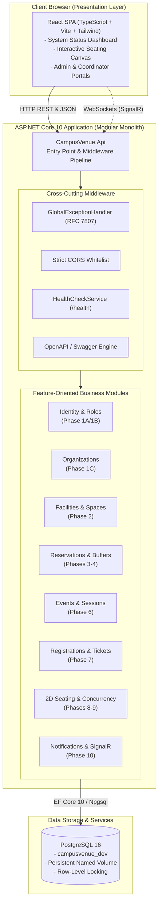
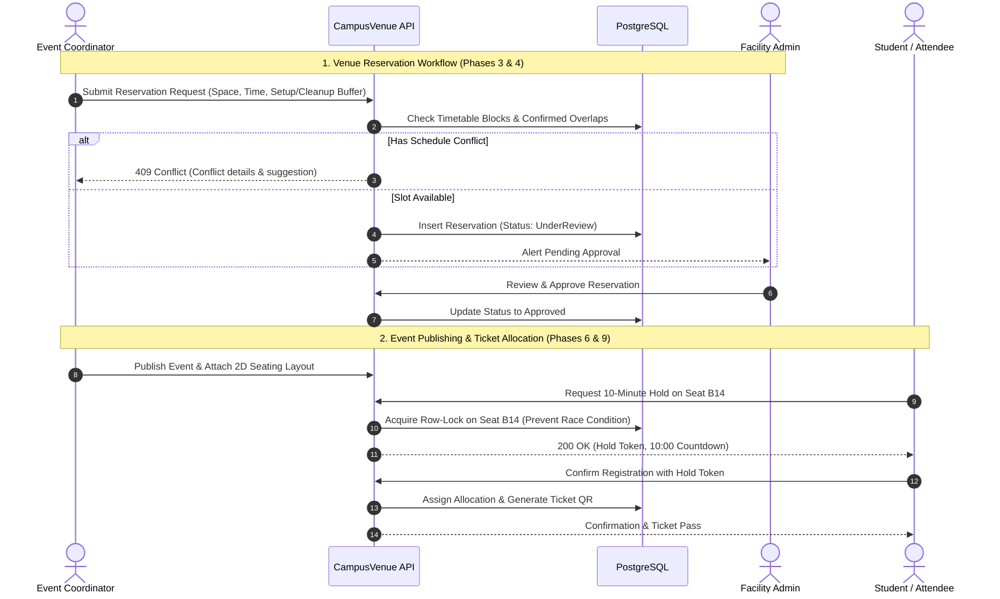

# CampusVenue — University Venue Reservation & Event Management Platform

> A production-oriented, modular enterprise web platform designed to streamline university venue discovery, timetable conflict detection, coordinator approval workflows, and concurrent-safe interactive seat reservation.

[](#17-current-ci-status)
[](LICENSE)
[](https://dotnet.microsoft.com/)
[](https://react.dev/)
[](https://www.postgresql.org/)

---

## 1. Project Overview & Value Proposition

University campuses house hundreds of diverse physical venues—historic auditoriums, tiered lecture theaters, specialized computer laboratories, seminar spaces, and multipurpose outdoor grounds. Historically, these venues are booked across fragmented departmental spreadsheets, informal emails, or rigid legacy calendaring systems. This causes frequent double-bookings, uncoordinated maintenance shutdowns, zero visibility into setup/teardown buffer times, and logistical chaos during high-demand campus symposiums and student events.

**CampusVenue** provides a unified, auditable, high-reliability platform that integrates space inventory, timetable conflict mathematics, coordinator approval state machines, 2D vector seating layouts, and concurrent-safe seat allocation under ACID transactional guarantees.

---

## 2. The Problem CampusVenue Solves

| Traditional Campus Bottleneck | CampusVenue Solution |
| ----------------------------- | -------------------- |
| **Siloed Departmental Spreadsheets** | Centralized, multi-tenant institutional venue catalog with role-based access control. |
| **Double-Bookings & Buffer Ignorance** | Temporal interval conflict engine factoring in mandatory setup and teardown buffer windows. |
| **Unexplainable Room Rejections** | Rule-based recommendation engine scoring spaces on capacity fit, AV equipment, and accessibility. |
| **Chaotic Event Ticketing & Race Conditions** | Concurrent-safe transactional seat holds (10-minute hold window) preventing double-booking. |
| **Outdated Information** | Real-time WebSocket synchronization (SignalR) and asynchronous event notifications. |

---

## 3. Target Users

- **University Administrator**: Manages organizational hierarchy, faculties, departments, institutional policies, and audits system-wide resource utilization.
- **Facility Administrator**: Maintains building and room definitions, audio-visual equipment inventories, availability calendars, and reviews booking requests for assigned buildings.
- **Event Coordinator** (Faculty, Staff, Society Leads): Requests venues, designs 2D seating layouts, publishes multi-session events, and monitors attendee registrations.
- **Participant / Student**: Browses public campus events, registers for general admission, reserves specific seats on interactive 2D maps, and checks in with digital tickets.

---

## 4. Core Product Capabilities

1. **Multi-Organization & Role Governance**: Structured organizational tenancy for faculties, academic departments, and student societies.
2. **Comprehensive Space Catalog**: Rich space definitions (auditoriums, seminar rooms, flexible spaces) with capacity limits, AV assets, and accessibility tags.
3. **Availability & Conflict Detection Engine**: Evaluates timetable blockouts, maintenance windows, and buffer times (`[Start - Setup]` to `[End + Cleanup]`).
4. **Auditable Approval Workflow**: Multi-stage state machine for reservation requests with automated conflict checks upon review.
5. **Explainable Hall Recommendation Engine**: Scores and ranks candidate venues with clear human-readable explanations.
6. **Event Lifecycle & Multi-Session Publishing**: Draft, publish, and manage multi-session academic and cultural events.
7. **Three Participant Admission Modes**: Assigned Seating, General Admission (capped), and Open (no registration required).
8. **Interactive 2D Seating Layout Editor**: Dynamic canvas/vector layout designer supporting sections, tiers, rows, and immutable layout versioning.
9. **Concurrent-Safe Seat Allocation**: High-concurrency seat locking with 10-minute hold countdowns backed by PostgreSQL row-level locks.
10. **Real-Time Push & Background Notifications**: Instant seat state synchronization via SignalR and transactional notifications.
11. **Attendance Check-In & Audit Trail**: Cryptographic QR code ticket validation and append-only audit trail for administrative actions.

---

## 5. Implemented vs. Planned Features

```
Phase 0 — Enterprise Foundation:  [====================] 100% (Completed & Verified)
Phases 1-13 — Business Features:  [                    ] 0%   (Planned)
```

| Capability | Status | Target Milestone | Description |
| ---------- | :----: | :--------------: | ----------- |
| **Monorepo Architecture & Rules** | :white_check_mark: **Implemented & Verified** | Phase 0 | Clean repo structure, strict 16 Antigravity rules, Docker Compose, CI pipeline. |
| **Health Check & Status Dashboard** | :white_check_mark: **Implemented & Verified** | Phase 0 | `/health` backend endpoint verifying PostgreSQL connectivity + React status UI. |
| **EF Core DbContext & Npgsql Setup** | :white_check_mark: **Implemented & Verified** | Phase 0 | PostgreSQL container configuration and EF Core DbContext registered without fake tables. |
| **.NET 10 LTS & C# 14 Foundation** | :white_check_mark: **Implemented & Verified** | Phase 0 | Target framework `net10.0`, SDK `10.0.404`, and ASP.NET Core 10 runtime verified. |
| **Identity & Authentication** | :hourglass: *Planned* | Phase 1A | ASP.NET Identity, secure HttpOnly cookies, password hashing, user registration/login. |
| **Roles & Authorization Policies** | :hourglass: *Planned* | Phase 1B | RBAC claims (`UniversityAdmin`, `FacilityAdmin`, `Coordinator`, `Participant`). |
| **University Organizations & Tenancy** | :hourglass: *Planned* | Phase 1C | Faculties, academic departments, student societies, coordinator assignment scoping. |
| **Buildings & Space Inventory** | :hourglass: *Planned* | Phase 2 | Space catalog, equipment metadata, accessibility tags, photo galleries. |
| **Availability Calendar & Buffer Math** | :hourglass: *Planned* | Phase 3 | Timetable blockouts, setup/teardown buffers, recurring semester rules. |
| **Coordinator Space Requests & Approvals** | :hourglass: *Planned* | Phase 4 | Reservation state machine, facility manager review queue, conflict alerts. |
| **Explainable Venue Recommendations** | :hourglass: *Planned* | Phase 5 | Algorithmic space ranking with human-readable score rationales. |
| **Event Creation & Publication** | :hourglass: *Planned* | Phase 6 | Multi-session events, public campus calendar, draft/publish lifecycle. |
| **Participant Registration & Tickets** | :hourglass: *Planned* | Phase 7 | Admission modes (assigned vs. general vs. open), digital tickets, QR codes. |
| **Interactive 2D Hall Layout Editor** | :hourglass: *Planned* | Phase 8 | SVG/Canvas layout designer, seat tiers, sections, immutable layout versions. |
| **Concurrent-Safe Seat Hold Engine** | :hourglass: *Planned* | Phase 9 | PostgreSQL serializable/row locks, 10-minute hold expiration worker. |
| **Real-Time SignalR & Notifications** | :hourglass: *Planned* | Phase 10 | WebSocket live seat state updates and background email alerts. |
| **Attendance Check-In & Audit Logs** | :hourglass: *Planned* | Phase 11 | QR check-in scanning, audit log viewer, venue utilization reporting. |
| **Cloud Hardening & Observability** | :hourglass: *Planned* | Phase 12 | OpenTelemetry traces/metrics, rate limiting, security headers. |
| **3D Hall Sightline Visualization** | :hourglass: *Planned* | Phase 13 | WebGL/Three.js virtual seat viewpoint perspective previews. |

---

## 6. Technical Stack & Architectural Justifications

### Backend
- **ASP.NET Core 10 LTS (C# 14 / .NET 10.0)**: High throughput, robust dependency injection, strong typing, and cross-platform reliability.
- **Modular Monolith**: Single deployable artifact with strict internal module boundaries, avoiding premature microservice complexity while preserving isolation.
- **Vertical Slice Architecture**: Feature logic, validation, data access, and endpoints co-located per use case.
- **Entity Framework Core 10 with Npgsql**: High-performance PostgreSQL provider with compiled queries and forward-only migrations.
- **RFC 7807 Problem Details**: Centralized, machine-readable error responses via `GlobalExceptionHandler`.
- **xUnit & FluentAssertions**: Comprehensive test coverage across unit and integration layers.

### Frontend
- **React 18 / 19 with TypeScript**: Declarative UI with strict compile-time type verification (`strict: true`, no `any`).
- **Vite**: Rapid Hot Module Replacement (HMR) and optimized Rollup production builds.
- **Tailwind CSS**: Utility-first styling for accessible, responsive layout without runtime CSS-in-JS overhead.
- **TanStack Query (React Query)**: Declarative server-state caching, automatic refetching, and background synchronization (starting Phase 1).
- **Vitest & React Testing Library**: Component unit and behavioral testing.

### Infrastructure & DevOps
- **PostgreSQL 16**: Relational storage supporting row-level locking, JSONB vector data, and temporal intervals.
- **Docker & Docker Compose**: Deterministic local development environment with automatic service healthchecks.
- **GitHub Actions**: Continuous integration running backend builds, tests, frontend linting, and Docker config validation on every commit.

---

## 7. High-Level System Architecture



---

## 8. Modular Backend Structure

The backend avoids arbitrary technical layers (Controllers/Services/Repositories) across the entire application. Instead, it partitions functionality into business modules, with internal vertical slices:

```
backend/CampusVenue.Api/
├── Common/                          # Shared envelopes (ApiResponse), models, records
├── Infrastructure/
│   ├── Data/                        # CampusVenueDbContext (EF Core configuration)
│   ├── Health/                      # Health check registration & JSON formatting
│   └── Middleware/                  # GlobalExceptionHandler (RFC 7807 Problem Details)
├── Modules/                         # Business modules (defined in Modules/MODULES.md)
│   ├── Identity/                    # (Phase 1A/1B) Authentication & RBAC
│   ├── Organizations/               # (Phase 1C) Faculties, departments, societies
│   ├── Facilities/                  # (Phase 2) Buildings, rooms, equipment
│   ├── Reservations/                # (Phases 3-4) Booking workflows & conflict math
│   ├── Events/                      # (Phase 6) Event publishing & sessions
│   ├── Registrations/               # (Phase 7) Participant tickets & admission modes
│   ├── Seating/                     # (Phases 8-9) 2D vector layouts & seat holds
│   └── Notifications/               # (Phase 10) Out-of-band alerts & SignalR
└── Program.cs                       # Minimal API bootstrapping & pipeline config
```

---

## 9. Main Business Workflows (Future Phases)



---

## 10. Requirements and Prerequisites

Before running CampusVenue locally, ensure you have:

- **Operating System**: Windows 10/11, macOS, or Linux.
- **Docker**: Docker Desktop (Windows/macOS) or Docker Engine (Linux) v24+.
- **Node.js**: v20 LTS (minimum v18+) & `npm` v10+.
- **.NET SDK**: .NET 10.0 SDK installed on host, **or** Docker to execute builds within the official Microsoft .NET 10 SDK container (`mcr.microsoft.com/dotnet/sdk:10.0-alpine`).
- **Git**: v2.40+.

---

## 11. Local Installation Instructions

1. **Clone or Navigate to the repository**:
   ```bash
   cd E:\CampusVenue
   ```

2. **Configure environment settings**:
   ```powershell
   Copy-Item .env.example .env
   ```

3. **Install Frontend dependencies**:
   ```powershell
   cd frontend
   npm install
   cd ..
   ```

---

## 12. Environment Configuration

CampusVenue uses environment variables for configuration. The table below lists the essential variables defined in `.env.example`:

| Variable | Default Value | Description |
| -------- | ------------- | ----------- |
| `ASPNETCORE_ENVIRONMENT` | `Development` | ASP.NET Core hosting environment. |
| `POSTGRES_DB` | `campusvenue_dev` | Local database name. |
| `POSTGRES_USER` | `campusvenue_user` | Local database user. |
| `POSTGRES_PASSWORD` | `campusvenue_dev_secret_change_me` | Local development password. |
| `POSTGRES_PORT` | `5432` | Exposed PostgreSQL port on host. |
| `ConnectionStrings__DefaultConnection` | `Host=localhost;...` | PostgreSQL connection string for API. |
| `VITE_API_BASE_URL` | `http://localhost:5000` | Backend API base URL for frontend client. |
| `AllowedCorsOrigins` | `http://localhost:3000` | Whitelisted CORS origins for API requests. |

---

## 13. Running the Application & PostgreSQL

### Step 1: Start PostgreSQL via Docker Compose
```powershell
docker compose up -d postgres
```
Verify PostgreSQL is healthy:
```powershell
docker compose ps
```

### Step 2: Run Backend API
- **Option A (Host .NET 10 SDK)**:
  ```powershell
  cd backend/CampusVenue.Api
  dotnet run
  ```
- **Option B (Docker .NET 10 SDK Container)**:
  ```powershell
  docker compose up -d --build backend
  ```

API starts on `http://localhost:5000`. Test the health endpoint:
```powershell
Invoke-RestMethod http://localhost:5000/health
```

### Step 3: Run Frontend Single Page App
In a separate terminal:
```powershell
cd frontend
npm run dev
```
Open your browser at `http://localhost:3000`.

---

## 14. Database Migration Guidance

All schema modifications are tracked through EF Core code-first migrations.
During **Phase 0**, no speculative business tables are created. In Phase 1+, use these standard commands:

```powershell
# Create a new migration for a feature
dotnet ef migrations add <MigrationName> --project backend/CampusVenue.Api

# Apply pending migrations to the local database
dotnet ef database update --project backend/CampusVenue.Api

# Generate an idempotent SQL migration script for review
dotnet ef migrations script --idempotent --project backend/CampusVenue.Api -o migration.sql
```

---

## 15. Testing Commands

### Backend Automated Tests
Execute the xUnit suite:
```powershell
# On Host (.NET 10 installed):
dotnet test backend/CampusVenue.sln

# Or via official .NET 10 Container:
docker run --rm -v "${PWD}/backend:/src" -w /src mcr.microsoft.com/dotnet/sdk:10.0-alpine dotnet test CampusVenue.sln
```

### Frontend Automated Tests & Linting
Execute the Vitest suite and TypeScript check:
```powershell
cd frontend
npm run typecheck # TypeScript strict type checking (tsc --noEmit)
npm run lint      # ESLint 9 code quality and React Hook validation
npm run test      # Vitest component test suite
npm run build     # Production bundle verification
```

---

## 16. Docker Development Commands

```powershell
# Build and run all services (PostgreSQL, Backend API, Frontend SPA)
docker compose up --build -d

# Run only PostgreSQL in background
docker compose up -d postgres

# Inspect live container logs
docker compose logs -f

# Stop all containers (preserving persistent database volume)
docker compose down

# Stop and wipe database volume (full reset)
docker compose down -v
```

---

## 17. Current CI Status

CampusVenue includes a multi-job Continuous Integration pipeline implemented in [`.github/workflows/ci.yml`](.github/workflows/ci.yml):

- **Backend CI Job**: Checks out code on Ubuntu, sets up .NET 10.0 SDK (`10.0.x`), restores NuGet dependencies, compiles in `Release` configuration, and executes all unit and integration tests.
- **Frontend CI Job**: Sets up Node.js 20, runs clean install (`npm ci`), executes TypeScript linting, runs Vitest component tests, and builds the production distribution bundle.
- **Infrastructure CI Job**: Runs `docker compose config` to guarantee Docker Compose syntax and service configurations remain valid.

---

## 18. Security & Configuration Considerations

1. **Zero Secret Commits**: Real passwords, tokens, and keys are strictly excluded via `.gitignore`. `.env.example` provides safe development placeholders only.
2. **Server-Side Authorization Invariants**: Client applications are never trusted for authorization decisions. Role and organization permissions are evaluated on every mutating endpoint.
3. **CORS Hardening**: CORS policies are restricted to explicitly configured origin URLs (`AllowedCorsOrigins`).
4. **Information Leakage Prevention**: In production mode, RFC 7807 Problem Details mask internal database syntax errors and stack traces. Structured logs never record raw passwords or personal sensitive data.

---

## 19. Development Roadmap Summary

CampusVenue adheres to a structured, 13-phase engineering roadmap:
- **Phase 0 (Completed & Verified)**: Enterprise Foundation, Rules, Architecture, CI, and Documentation.
- **Phase 1**: Identity, Roles, and University Organizations (Decomposed into Slices 1A, 1B, 1C).
- **Phase 2**: Buildings and Reservable Spaces.
- **Phase 3**: Availability Calendar and Scheduling Buffer Constraints.
- **Phase 4**: Coordinator Space Requests and Approval Workflow.
- **Phase 5**: Explainable Hall Recommendation Engine.
- **Phase 6**: Event Creation and Multi-Session Publication.
- **Phase 7**: Participant Registration and Admission Modes.
- **Phase 8**: Interactive 2D Hall Layout Editor.
- **Phase 9**: Concurrent-Safe Seat Reservation and Allocation Engine.
- **Phase 10**: Real-Time Updates via SignalR and Reliable Notifications.
- **Phase 11**: Attendance Check-In via QR Codes and Audit History.
- **Phase 12**: Cloud Deployment, Observability, and Security Hardening.
- **Phase 13**: Optional 3D Hall Sightline Visualization.

See [docs/product/roadmap.md](docs/product/roadmap.md) for detailed deliverables, API contracts, and acceptance criteria for every milestone.

---

## 20. Documentation Index

- **Product Specifications**:
  - [Product Requirements Specification](docs/product/requirements.md)
  - [Comprehensive 13-Phase Roadmap](docs/product/roadmap.md)
- **Architecture & Design**:
  - [System Architecture & C4 Diagrams](docs/architecture/system-architecture.md)
  - [Backend Module Boundaries](backend/CampusVenue.Api/Modules/MODULES.md)
- **Architecture Decision Records (ADRs)**:
  - [ADR 0001: Modular Monolith Architecture](docs/architecture/adr/0001-modular-monolith-over-microservices.md)
  - [ADR 0002: Vertical Slice Architecture](docs/architecture/adr/0002-vertical-slice-architecture.md)
  - [ADR 0003: PostgreSQL and EF Core](docs/architecture/adr/0003-postgresql-and-efcore.md)
  - [ADR 0004: RESTful APIs and SignalR](docs/architecture/adr/0004-rest-api-and-signalr.md)
  - [ADR 0005: React, TypeScript, and Vite Frontend](docs/architecture/adr/0005-react-typescript-vite-frontend.md)
  - [ADR 0006: CI/CD & Initial Container Strategy](docs/architecture/adr/0006-ci-cd-and-deployment-strategy.md)
- **Developer Guides**:
  - [Local Development Setup](docs/development/local-setup.md)
  - [Coding & Naming Conventions](docs/development/conventions.md)
  - [Testing & Quality Assurance Strategy](docs/testing/testing-strategy.md)
  - [Docker & Container Infrastructure Guide](docs/deployment/docker-compose-guide.md)
  - [Phase 0 Completion Report](docs/progress/phase-0-completion.md)
- **Governance**:
  - [Antigravity Engineering Directives](AGENTS.md)
  - [Contributing Guidelines](CONTRIBUTING.md)
  - [Security Policy](SECURITY.md)

---

## 21. Project Status & Known Limitations

- **Current Status**: **Phase 0 Completed & Verified**.
- **Known Limitations in Phase 0**:
  - No business entities (spaces, reservations, events) exist in the database yet. This is by design: business logic begins in Phase 1 upon approval.
  - Authentication endpoints are not yet registered; `/health` is public.
  - The host operating system currently has the .NET 8 Runtime installed without the full host SDK; running .NET build/tests on this machine utilizes the official Docker SDK container (`10.0-alpine` / `10.0.404`).

---

## 22. Future Improvements (Post-Phase 12)

- Multi-institution federation (allowing cross-university symposiums).
- Native calendar integration (iCal, Google Calendar, Outlook synchronization).
- Automated timetable sync with institutional Student Information Systems (SIS).
- Mobile event management app for field staff badge scanning.

---

## 23. Troubleshooting

### Port 5432 or 5000 is already in use
If another PostgreSQL instance is running on your host, edit `.env`:
```ini
POSTGRES_PORT=5433
ConnectionStrings__DefaultConnection=Host=localhost;Port=5433;Database=campusvenue_dev;...
```

### Docker health check fails on PostgreSQL
Check container logs:
```powershell
docker compose logs postgres
```
Verify disk permissions and restart the service with `docker compose restart postgres`.

### Frontend fails to proxy `/health`
Ensure the backend API is running on port 5000 before initiating the frontend dev server. If using Docker Compose, access the frontend at `http://localhost:3000` which automatically routes `/health` to `http://backend:5000/health`.
