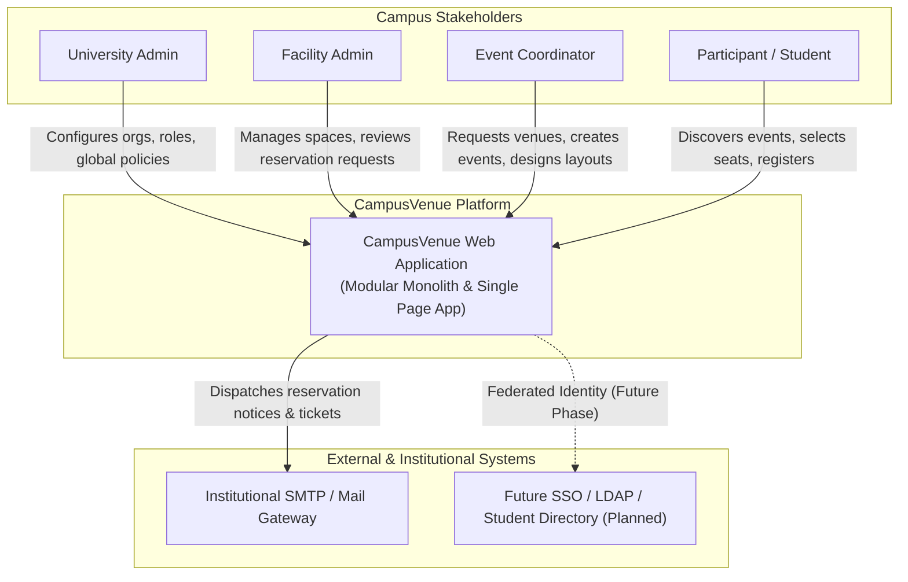
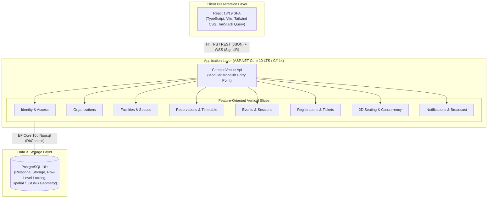
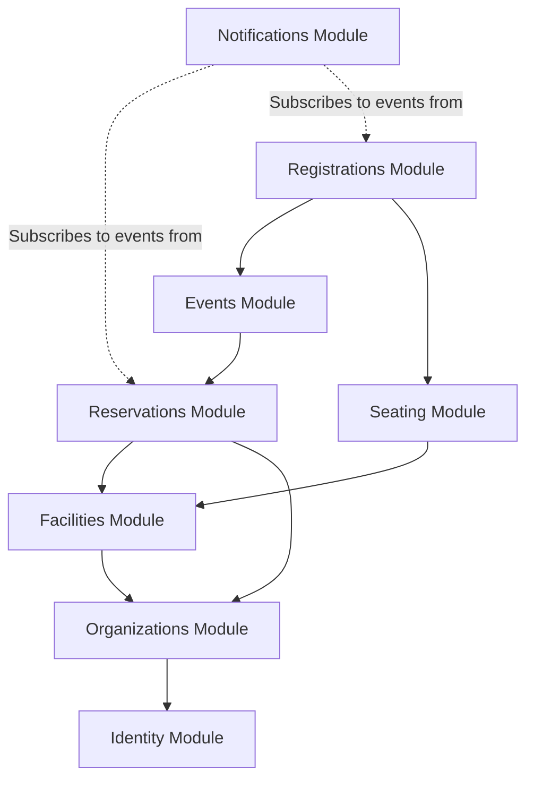
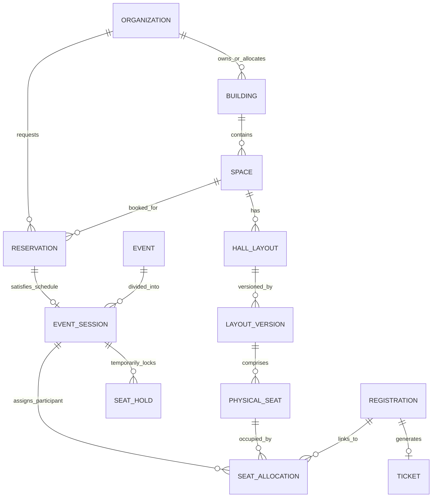

# CampusVenue — System Architecture & Technical Design

## 1. System Context Diagram (C4 Level 1)



---

## 2. Container-Level Architecture (C4 Level 2)



---

## 3. Initial Module Dependency Diagram

To preserve modular monolith integrity, modules must adhere to strict boundary rules:
- Higher-level orchestration modules may depend on lower-level domain modules via well-defined contracts.
- Bidirectional circular dependencies are strictly forbidden.
- Modules never query other module database tables directly.



---

## 4. High-Level Conceptual ERD (Domain Entities Overview)

> [!NOTE]
> This ERD represents the long-term conceptual domain model across the entire roadmap. During **Phase 0**, no speculative business tables are created in the database.



---

## 5. API Design Conventions

1. **Protocol & Data Format**:
   - Standard RESTful JSON over HTTPS.
   - Resource-based URI hierarchy: e.g., `/api/spaces`, `/api/spaces/{id}/reservations`.
2. **HTTP Verbs**:
   - `GET`: Safe, idempotent retrieval.
   - `POST`: Create a new resource or trigger an action.
   - `PUT`: Complete resource replacement.
   - `PATCH`: Partial resource update.
   - `DELETE`: Remove a resource.
3. **HTTP Status Codes**:
   - `200 OK`: Request succeeded with response body.
   - `201 Created`: Resource successfully created (with `Location` header).
   - `204 No Content`: Successful mutation returning no payload.
   - `400 Bad Request`: Malformed syntax or client request format error.
   - `401 Unauthorized`: Missing or invalid authentication token.
   - `403 Forbidden`: Authenticated user lacks permission.
   - `404 Not Found`: Target resource does not exist.
   - `409 Conflict`: Business invariant conflict (e.g., room already reserved, seat held by another user).
   - `422 Unprocessable Entity`: Validation failure on request payload.
   - `500 Internal Server Error`: Unhandled server exception (masked from client).

---

## 6. Error Response Conventions (RFC 7807 Problem Details)

All error responses from CampusVenue API follow RFC 7807 `application/problem+json`:

```json
{
  "type": "https://campusvenue.internal/errors/scheduling-conflict",
  "title": "Venue Scheduling Conflict",
  "status": 409,
  "detail": "The requested space 'Auditorium 1' is already reserved between 14:00 and 16:00 UTC including mandatory cleanup buffer.",
  "instance": "/api/reservations",
  "extensions": {
    "conflictingReservationId": "3fa85f64-5717-4562-b3fc-2c963f66afa6",
    "traceId": "00-4bf92f3577b34da6a3ce929d0e0e4736-00f067aa0ba902b7-01"
  }
}
```

---

## 7. Authentication & Authorization Plan

1. **Phase 1 Strategy**:
   - Utilize ASP.NET Core Identity for secure credential storage, password hashing (PBKDF2/Argon2), and lockout policies.
   - Issue cryptographically signed secure HttpOnly, SameSite cookies for session management (recommended for same-origin SPA).
2. **Claims-Based Authorization**:
   - `PermissionRequirement` policies evaluated dynamically:
     - `RequireRole("UniversityAdmin")`
     - `RequireBuildingAccess("FacilityAdmin")`
     - `RequireOrgMembership("Coordinator")`
3. **Multi-Tenant / Scoped Access Control**:
   - Facilities and reservations are tied to university organizational units. Cross-organizational actions require elevated institutional privileges.

---

## 8. Database Migration Approach

1. **Tooling**: EF Core Migrations via `dotnet ef`.
2. **Discipline**:
   - Code-First entity configuration using `IEntityTypeConfiguration<T>`.
   - Never write speculative migrations before their designated phase.
   - In production CI/CD, apply migrations using idempotently generated SQL migration scripts (`dotnet ef migrations script --idempotent`) executed during staging pipeline deployment.
3. **Zero-Downtime Migration Pattern**:
   - Expand-contract pattern for schema changes: add new nullable column &rarr; write to both &rarr; migrate historical data &rarr; switch reads &rarr; drop legacy column.

---

## 9. Testing Architecture

```
CampusVenue/
├── backend/
│   └── CampusVenue.Tests/
│       ├── Unit/                  # Pure algorithm & domain invariant tests
│       ├── Integration/           # WebApplicationFactory + Testcontainers PG
│       └── Architecture/          # Architecture boundary & convention tests
├── frontend/
│   └── src/
│       ├── components/**/*.test.tsx  # Component render & interaction tests
│       └── features/**/*.test.tsx    # Feature workflow & state tests
└── (Future Phase) e2e/               # Playwright cross-browser scenarios
```

---

## 10. Development & Deployment Environments

| Environment | Purpose | Infrastructure | Configuration Source |
| ----------- | ------- | -------------- | -------------------- |
| **Local Dev** | Rapid iteration & debugging | Host / Docker Compose (PostgreSQL 16) | `appsettings.Development.json`, `.env` |
| **CI (GitHub Actions)** | Validation, lint, test, build | Ubuntu GitHub Runners + Docker services | Repository Secrets / Mock envs |
| **Staging (Phase 12)** | Realistic rehearsal & performance tests | Linux VM / Container App + Managed PG | Cloud Key Vault / Environment Variables |
| **Production (Phase 12)** | Live institutional usage | Scaled Container Service + Cloud Managed PG | Cloud Secrets Manager + TLS Certificates |
